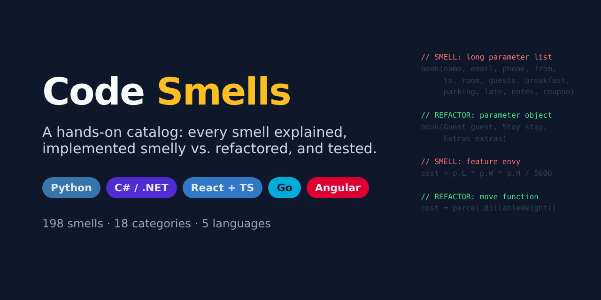

<a id="top"></a>

<p align="center">
  
</p>

# Code Smells — a hands-on catalog in Python, C#/.NET, React + TypeScript, Go and Angular

[](https://github.com/danielfyo/code-smells/actions/workflows/ci.yml)
[](https://github.com/danielfyo/code-smells/actions/workflows/codeql.yml)
[](https://scorecard.dev/viewer/?uri=github.com/danielfyo/code-smells)
[](https://github.com/danielfyo/code-smells/releases)
[](LICENSE)
[](https://www.conventionalcommits.org/en/v1.0.0/)


> *"If it stinks, change it."* — Kent Beck

An educational repository with **198 code smells** organized in **18 categories**, each one with:

- 📖 **An explanation page**: definition, symptoms, causes, consequences, example, solution,
  recommended refactorings, exceptions, related smells, automatic detection and references.
- 💻 **Implementations in 5 languages** (generic smells) or in their own language (idiomatic smells):
  a **`smelly`** version (with the smell, marked with `SMELL:` comments) and a **`refactored`** version
  (the fix, with `REFACTOR:` comments naming the technique applied).
- ✅ **Tests** proving both versions behave the same — or exposing the bug hidden behind the smell.

## Contents

| # | Category | Smells | Origin |
|---|---|---:|---|
| 01 | [Bloaters](docs/smells/01-bloaters/) | 5 | Fowler, Mäntylä |
| 02 | [Object-Orientation Abusers](docs/smells/02-oo-abusers/) | 6 | Fowler, Clean Code |
| 03 | [Change Preventers](docs/smells/03-change-preventers/) | 4 | Fowler, Kerievsky |
| 04 | [Dispensables](docs/smells/04-dispensables/) | 7 | Fowler, Clean Code |
| 05 | [Couplers](docs/smells/05-couplers/) | 9 | Fowler 1999/2018, Clean Code |
| 06 | [Data Dealers](docs/smells/06-data/) | 6 | Fowler 2018, Jerzyk |
| 07 | [Functions & Conditional Logic](docs/smells/07-functions/) | 8 | Clean Code, Jerzyk |
| 08 | [Error Handling](docs/smells/08-error-handling/) | 5 | Clean Code, Jerzyk |
| 09 | [Comments](docs/smells/09-comments/) (C1-C5) | 5 | Clean Code |
| 10 | [Names](docs/smells/10-names/) (N1-N7) | 10 | Clean Code, Fowler, Jerzyk |
| 11 | [General](docs/smells/11-general/) (G1-G36) | 14 | Clean Code, Kerievsky, Jerzyk |
| 12 | [Test Smells](docs/smells/12-tests/) (T1-T9) | 11 | Clean Code, Meszaros, van Deursen |
| 13 | [Environment](docs/smells/13-environment/) (E1-E2) | 2 | Clean Code |
| 14 | [Python-specific](docs/smells/14-python/) | 20 | PEP 8, Pylint, Little Book of Python Anti-Patterns |
| 15 | [C# / .NET-specific](docs/smells/15-csharp/) | 20 | Microsoft, D. Fowler, M. Seemann |
| 16 | [React + TypeScript-specific](docs/smells/16-react-ts/) | 22 | react.dev, typescript-eslint |
| 17 | [Go-specific](docs/smells/17-go/) | 22 | Effective Go, Code Review Comments, 100 Go Mistakes |
| 18 | [Angular-specific](docs/smells/18-angular/) | 22 | angular.dev, RxJS, angular-eslint |
| | **Total** | **198** | |

➡️ **[Full catalog with every smell and link](docs/CATALOG.md)**

## Where to start

1. [Introduction: what a code smell is, history and taxonomies](docs/INTRODUCTION.md)
2. [Full catalog](docs/CATALOG.md)
3. [Repository conventions](docs/CONVENTIONS.md)
4. Per-language indexes: [Python](python/INDEX.md) · [C#](csharp/INDEX.md) · [React + TS](react-ts/INDEX.md) · [Go](go/INDEX.md) · [Angular](angular/INDEX.md)

## Layout

```
.
├── catalog.json              # Single source of truth (generated from tools/catalog_data.py)
├── docs/
│   ├── INTRODUCTION.md
│   ├── CATALOG.md            # Generated
│   ├── CONVENTIONS.md
│   └── smells/<NN-category>/<slug>.md
├── python/code_smells/<category>/<slug>/        smelly.py · refactored.py · test_*.py
├── csharp/src/CodeSmells/<Category>/<Slug>/     Smelly.cs · Refactored.cs
│   └── tests/CodeSmells.Tests/<Category>/       <Slug>Tests.cs (xUnit)
├── react-ts/src/smells/<category>/<slug>/       Smelly.tsx · Refactored.tsx · *.test.tsx (Vitest)
├── go/smells/<category>/<slug>/                 smelly/ · refactored/ (with _test.go)
├── angular/src/smells/<category>/<slug>/        smelly.ts · refactored.ts · *.spec.ts (Vitest + TestBed)
└── tools/                    # Catalog generation and verification
```

## Running the examples

Requirements: Python 3.11+ with `pytest`, .NET 8 SDK, Node 22.22+ and Go 1.24.

```bash
make all          # everything: catalog + the 5 languages
make python       # cd python   && python3 -m pytest
make csharp       # dotnet test CodeSmells.sln (repo root)
make react-ts     # cd react-ts && npm ci && npm run check
make go           # cd go       && go vet ./... && go test ./...
make angular      # cd angular  && npm ci && npm run check
```

The GitHub Actions workflow (`.github/workflows/ci.yml`) runs the same checks on every push.

## Quality gates

Smelly code is bad **on purpose**, so every linter and analyzer is switched off for `smelly` files only.
Everything else — refactored code, the production code behind the test smells, and the clean tests — must
pass the same gates locally and in CI:

| Area | Checks |
| --- | --- |
| Catalog | generated files up to date, every smell has docs + 4 implementations, no broken Markdown links |
| Python | Ruff (lint + format), mypy `--strict`, pytest with branch coverage |
| C# / .NET | warnings as errors, .NET analyzers `latest-recommended`, code style enforced in build, NuGet lock files |
| React + TS | TypeScript `strict`, Vitest + Testing Library with coverage, `npm audit` |
| Go | `gofmt`, `go vet`, `go test -race` with coverage |
| Angular | `strictTemplates` + extended diagnostics as errors, Vitest + TestBed with coverage, production build, `npm audit` |
| Security | CodeQL (C#, Python, Go, JS/TS + workflows), OpenSSF Scorecard, Dependabot, SHA-pinned actions, least-privilege tokens |

Formatting is shared through [`.editorconfig`](.editorconfig) and line endings through
[`.gitattributes`](.gitattributes).

## Adding a new smell

1. Add it to `tools/catalog_data.py` and run `python3 tools/build_catalog.py`.
2. Write its page at the `doc` path listed in `catalog.json`.
3. Implement `smelly` + `refactored` + tests at every `code` path.
4. `python3 tools/check_catalog.py --strict` must finish with no missing items.
5. Commit using [Conventional Commits](https://www.conventionalcommits.org/).

See [CONTRIBUTING.md](CONTRIBUTING.md) for the full workflow.

## Community

- [Contributing guide](CONTRIBUTING.md) · [Code of Conduct](CODE_OF_CONDUCT.md) · [Security policy](SECURITY.md)
- [Changelog](CHANGELOG.md) — generated by release-please from Conventional Commits.
- Licensed under the [MIT License](LICENSE).

## Sources

Fowler & Beck, *Refactoring* (1999, 2018) · Martin, *Clean Code* (2008, ch. 17) · Kerievsky,
*Refactoring to Patterns* (2004) · Mäntylä & Lassenius (2006) · Meszaros, *xUnit Test Patterns* (2007) ·
Jerzyk & Madeyski, [codesmells.org](https://codesmells.org) (2023) ·
[Refactoring.Guru](https://refactoring.guru/refactoring/smells) ·
[Martin Fowler — CodeSmell](https://martinfowler.com/bliki/CodeSmell.html) ·
official documentation of each language. See the [Introduction](docs/INTRODUCTION.md#main-sources).

<p align="right"><a href="#top">Back to top ↑</a></p>
